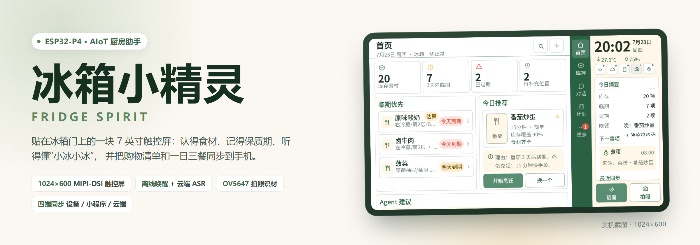
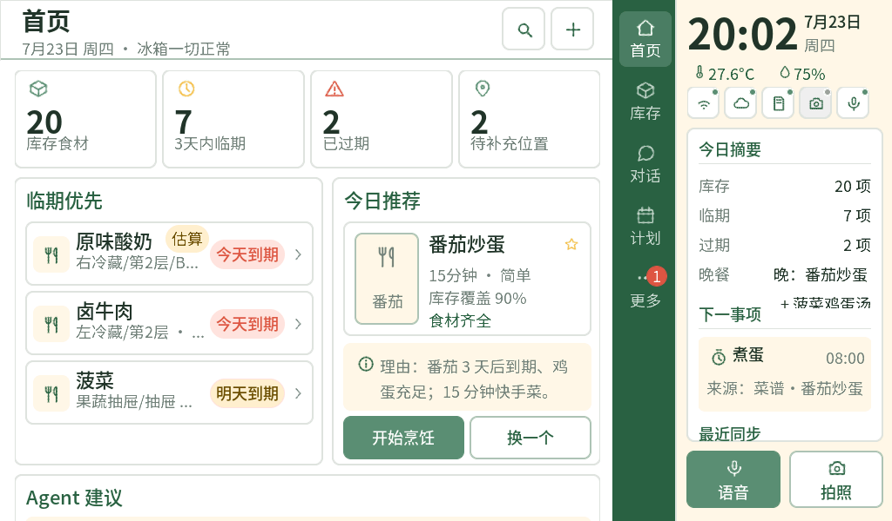
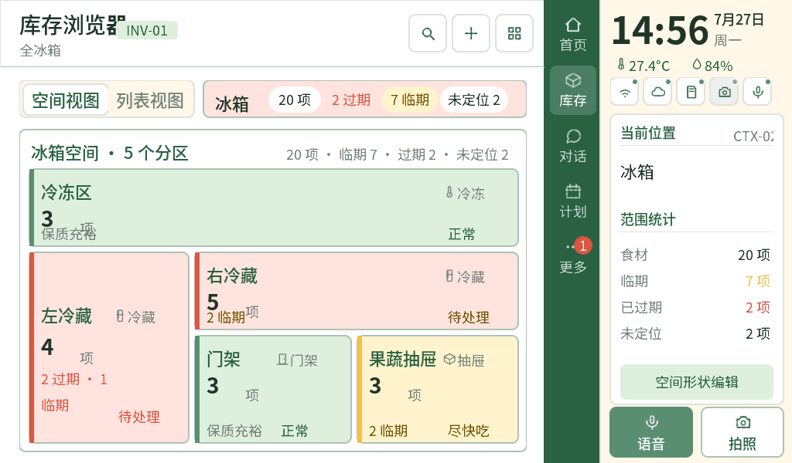
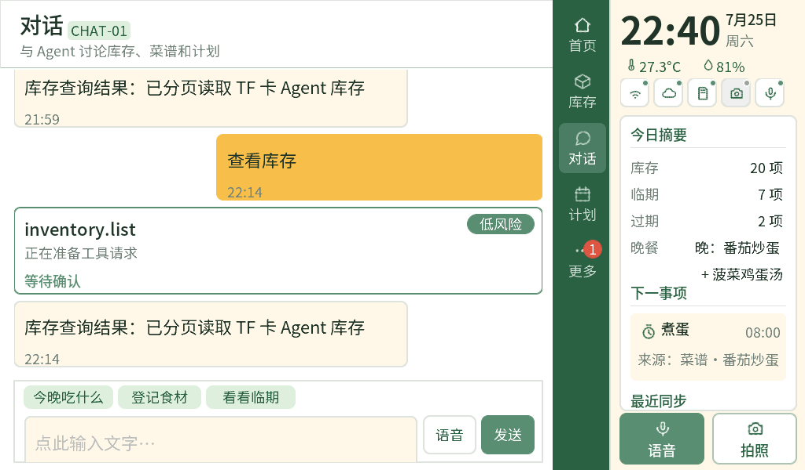
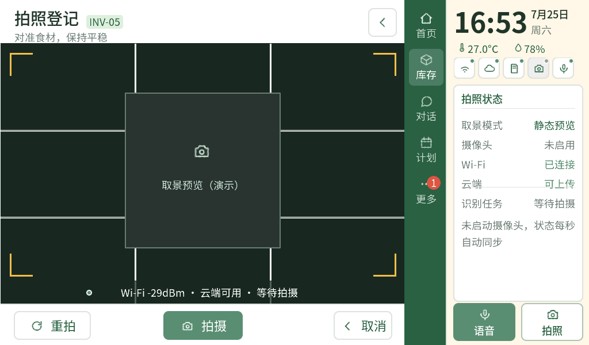
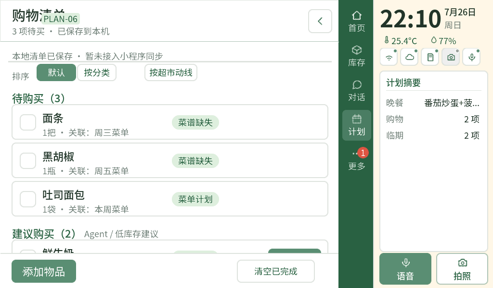
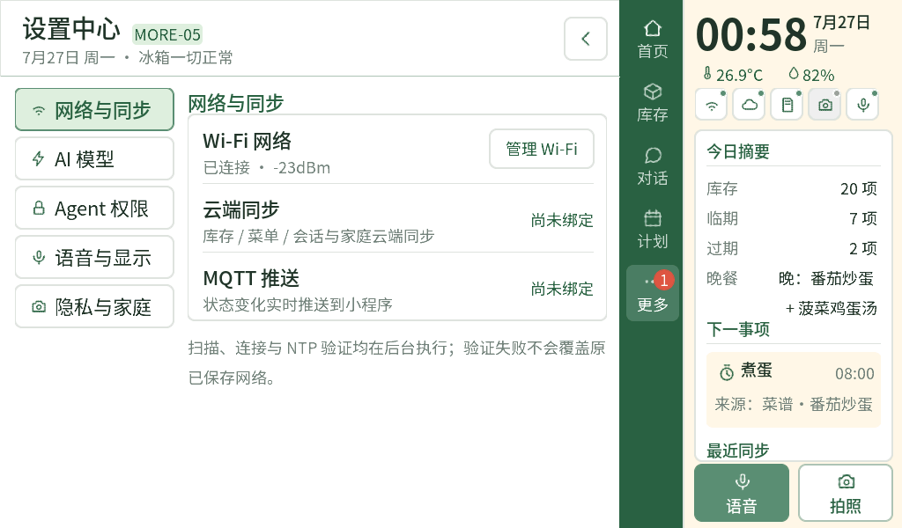
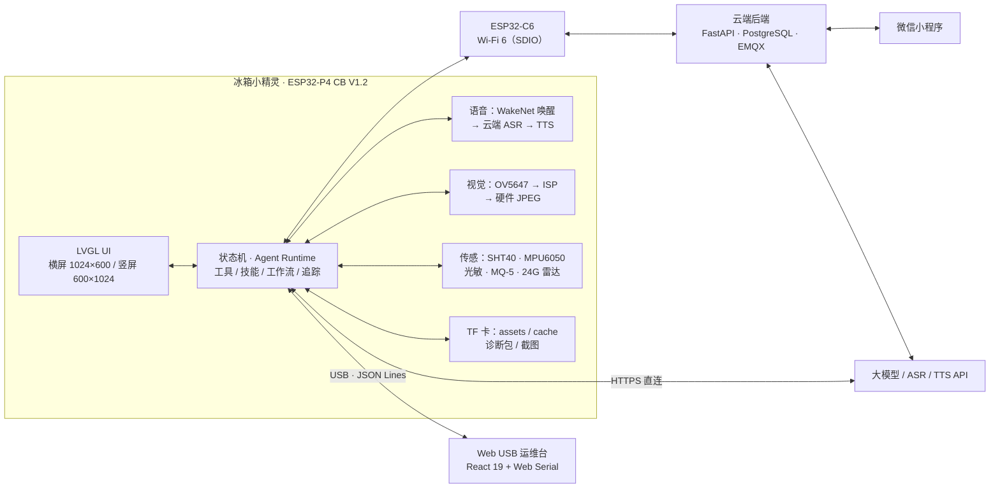

<div align="center">



# 冰箱小精灵 · Fridge Spirit

**贴在冰箱门上的 AI 厨房管家**

ESP32-P4 主控 · 7 英寸 MIPI-DSI 触控屏 · 离线语音唤醒 · 拍照识材 · 设备 / 小程序 / 云端四端同步

<p>
  
  
  
  
  
  
</p>

</div>

---

## 这是什么

**冰箱小精灵**是一块贴在冰箱门上的 7 英寸触控屏，也是一台完整跑在本地的小型 AIoT 设备。

它解决的是厨房里最琐碎、也最容易浪费的三件事：

- **买了就忘**：食材入库时拍一张照，位置、数量、保质期自动进库存，临期前主动提醒。
- **临期浪费**：按"先吃快到期的"排序，直接给出可执行的菜谱，而不是丢给你一堆搜索结果。
- **不知道吃什么**：把库存、临期、口味偏好交给 Agent，输出今日菜单 + 缺什么就买什么的购物清单。

整体思路是 **"端侧确定性 + 云端智能"**：屏幕、库存、定时器、提醒这些高频交互全部在设备本地闭环，断网也能用；需要理解与推理的部分（识材、菜谱、对话）再交给云端大模型。设备不是云端的遥控器，而是一个能独立工作的终端。

---

## 界面一览

> 全部为真机截屏（1024 × 600），非设计稿。

| 首页 · 一屏看懂冰箱 | 库存 · 空间化分区视图 |
| --- | --- |
|  |  |
| 库存 / 临期 / 过期 / 待补位置四个数字直接给结论，下面是"临期优先"和"今日推荐"，右侧常驻时钟、温湿度与今日摘要。 | 把冰箱拆成冷冻、左冷藏、右冷藏、门架、果蔬抽屉五个空间分区，每一区用颜色和角标标出临期与过期，先找得到再谈管理。 |

| 对话 · 会动手的 Agent | 拍照登记 · 视觉入库 |
| --- | --- |
|  |  |
| 自然语言直接查库存、改计划。涉及写操作时 Agent 会先抛出 `inventory.list` 这类工具请求并标注风险等级，等你确认再执行。 | OV5647 取景预览 + 十字构图辅助，拍照后走硬件 JPEG 上传云端识别，识别结果回到库存草稿。 |

| 计划 · 今日菜单与购物清单 | 设置中心 · 网络与 AI |
| --- | --- |
|  |  |
| 早/午/晚/加餐四餐菜单、待购买清单、临期利用计划同屏；购物清单支持按分类和超市动线排序。 | Wi-Fi 扫描连接、AI Provider 与模型、Agent 权限、语音与显示、隐私与家庭五个分区，全部可离线修改。 |

除了横屏主界面，同一套 LVGL 代码还提供 600 × 1024 的竖屏布局（首页、库存、对话、计划、更多），在设备竖装或手持调试时自动切换。

---

## 核心能力

**01 · 空间化库存**

不止是"一个列表"。库存按冰箱真实分区组织，支持空间视图 / 列表视图切换、未定位食材提示、位置形状编辑；每一项都带来源（手动 / 拍照识别 / Agent 估算）和置信度标记。

**02 · 临期优先的提醒链路**

入库即算到期日，临期与过期用红黄两级标注；系统按"3 天内临期"聚合，配合首页的"临期优先"卡片和提醒中心，把"该吃了"变成可点击的下一步动作。

**03 · 会说人话的菜谱**

菜谱不是静态文档，而是与库存耦合的结构化数据：库存覆盖率、预计耗时、难度、缺失食材一次算清，缺的东西一键加入购物清单。

**04 · 会动手的 Agent**

设备内置 Agent Runtime：工具注册表（`tool_system`）、技能调度（`skill_manager`）、工作流引擎（`workflow_engine`）、调用追踪（`trace_service`）、长期记忆（`agent_storage`）。所有工具调用带风险等级，写操作必须经过用户确认，不会"自己动手"。

**05 · 离线唤醒 + 云端理解**

WakeNet（esp-sr 2.4.5）在本地常驻监听唤醒词"小冰小冰"，只有唤醒后才走云端 ASR 与大模型，既省电也省流量；TTS 回放走板载 ES8311 + NS4150B。

**06 · 视觉入库**

OV5647 走 MIPI-CSI，RAW10 经 P4 ISP 转 RGB565，抓拍时用硬件 JPEG 编码，降低主核占用；预览 1280 × 720 实时刷新，拍照与语音共享的 SCCB/I2C 总线做了严格的串行化。

**07 · 厨房时间工具**

定时器、闹钟、秒表都做成了"厨房形态"：大字号、快捷预设、到点播报，且与提醒中心共用同一套调度。

**08 · 四端同步与可运维**

设备 ↔ 云端走 MQTT v2 结构化同步（12 个业务域），微信小程序负责登录、扫码绑定与远程查看；设备侧另有 TF 卡存储工作台（回收站、分块 CRC 传输、诊断包导出）和 Web USB 运维台，出问题能查、能导、能升级。

---

## 系统架构



三条链路各自独立：**本地链路**（UI / 状态机 / 传感器）不依赖网络；**云端链路**（C6 → EMQX → 后端 → 小程序）负责多端同步；**AI 链路**（设备直连 OpenAI 兼容 API）负责理解与生成。任意一条断开，其余仍可工作。

---

## 硬件配置

| 项目 | 型号 / 规格 |
| --- | --- |
| 主控 | 慧勤智远 ESP32-P4 CB V1.2 · ESP32-P4NRW32，双核 RISC-V @360 MHz |
| 内存 / 存储 | 32 MB PSRAM @200 MHz + 16 MB QSPI Flash（W25Q128） |
| 屏幕 | WKS70WSV114-WCT · 7 英寸 MIPI-DSI 1024×600（EK79007，2-lane）+ GT911 电容触摸 |
| 联网 | 板载 ESP32-C6-MINI-1，SDIO 接入，`esp_hosted` 2.12.11 + `esp_wifi_remote`，Wi-Fi 6 / BLE |
| 音频 | ES8311 编解码 + NS4150B 功放；FY-SP703 离线语音模组作默认录音源 |
| 视觉 | OV5647 MIPI-CSI（RAW10 → ISP → 硬件 JPEG），与音频共享 SCCB/I2C 需串行化 |
| 传感器 | SHT40 温湿度 · MPU6050 六轴 · 光敏（GPIO19 / ADC1_CH3）· MQ-5 燃气（GPIO20 / ADC1_CH4）· 24 GHz 人体雷达（UART） |
| 存储扩展 | TF 卡（SDMMC Slot0，与 C6 共享 LDO4 电源域） |
| 调试接口 | CH343P USB 串口 + 原生 USB-Serial/JTAG，JSON Lines 协议 |

<details>
<summary><b>Flash 分区布局（16 MB）</b></summary>

| 分区 | 类型 | 大小 | 用途 |
| --- | --- | --- | --- |
| `ota_0` | app | 6 MB | 主固件 |
| `ota_1` | app | 2 MB | 本地 recovery |
| `assets` | data (LittleFS) | 4 MB | UI 资源、字体 |
| `cache` | data | 1 MB | 运行时缓存 |
| `model` | data | 2 MB | ESP-SR 声学模型 |
| `coredump` | data | 768 KB | 崩溃现场 |

</details>

---

## 技术栈

| 层 | 技术选型 |
| --- | --- |
| 固件 | ESP-IDF 5.5.1（riscv GCC 14.2）· FreeRTOS · LVGL 9.2.2 · esp-sr 2.4.5 · esp_cam_sensor 0.5.3 · esp_codec_dev 1.5.4 |
| 设备 Agent | 自研 `agent_runtime` / `tool_system` / `skill_manager` / `workflow_engine` / `trace_service` / `agent_storage` |
| 管理前端 | React 19 + TypeScript + Vite，Web Serial 直连设备 |
| 云后端 | Python 3.11 · FastAPI · SQLAlchemy async · PostgreSQL 16 · EMQX 5 · Nginx |
| 小程序 | 微信小程序（登录、扫码绑定、库存 / 计划同步、WebSocket） |

---

## 快速开始

### 1. 固件

```powershell
# 环境：ESP-IDF v5.5.1（tools\idf.ps1 已固定路径，无需手动 export）
# 首次或切换版本后先重建配置，确保 flasher_args.json 中 stub=false
powershell -NoProfile -ExecutionPolicy Bypass -File tools\idf.ps1 reconfigure build

# 烧录并打开串口监视器（把 COM15 换成实际串口号）
powershell -NoProfile -ExecutionPolicy Bypass -File tools\idf.ps1 -p COM15 flash monitor
```

> CH343P 串口在 esptool 的 RAM stub 阶段容易握手失败，本项目统一使用 ROM loader（`stub=false`、115200）。换板后先在设备管理器确认端口号，并确保 `idf.py monitor`、Web 面板、串口助手不会同时占用同一个口。

### 2. Web USB 运维台

```bash
cd web
npm install
npm run dev      # 浏览器打开后用 Chrome / Edge，点击"连接"选择串口
```

涵盖总览、USB 连接、网络配置、AI 助手、Realtime 语音、摄像头 / 麦克风 / 扬声器 / 雷达测试、GPIO、传感器、日志、诊断与 TF 卡管理工作台。

### 3. 云端与小程序

```bash
cd backend
cp .env.example .env      # 填 JWT_SECRET、WX_APPID/SECRET、数据库口令等
docker compose up -d --build
curl http://localhost:6005/healthz
```

小程序工程在 `miniapp/`，用微信开发者工具导入即可；接口以 `/api/v2` 为唯一业务协议。

---

## 仓库结构

```
fridge_spirit_p4/
├── main/                    # 启动编排：初始化顺序、健康门、能力开关
├── components/              # 44 个功能组件，硬件层与业务层分离
│   ├── ui/  ui_p4/          # LVGL 横屏页面 / 竖屏页面
│   ├── display_mipi/ touch/ # MIPI-DSI 面板、GT911
│   ├── camera/              # OV5647 + ISP + 硬件 JPEG
│   ├── audio/ codec_es8311/ fy_sp703/ wake_word/ asr/ voice_session/
│   ├── sensors/ sht4x/      # SHT40 / MPU6050 / 光敏 / MQ-5
│   ├── agent_runtime/ tool_system/ skill_manager/ workflow_engine/
│   ├── kitchen_ai/ kitchen_tools/ ai_client/ ai_context/ ai_actions/
│   ├── mqtt_protocol/ network/ device_binding/ c6_ota/ glm_realtime/
│   ├── tfcard/ tf_http/ storage/ screenshot/ diagnostics/ diagnostics_log/
│   └── usb_protocol/        # 上位机 JSON Lines 协议
├── backend/                 # FastAPI 云端后端（/api/v2 + MQTT v2）
├── miniapp/                 # 微信小程序
├── web/                     # React 19 USB 运维台
├── doc/                     # 设计文档、接线方案、进度与踩坑记录
├── tools/                   # idf.ps1、截屏、C6 OTA 等脚本
└── partitions_recovery_p4.csv
```

---

## 文档索引

| 文档 | 内容 |
| --- | --- |
| [`doc/progress.md`](doc/progress.md) | 阶段性进度记录，含每次改动的验证结论 |
| [`doc/memory.md`](doc/memory.md) | 已验证接线、串口占用、编码与联调踩坑（改硬件前必读） |
| [`doc/项目架构与工作流设计.md`](doc/项目架构与工作流设计.md) | 整体架构与开发工作流 |
| [`doc/IDF5.5迁移与已验证版本.md`](doc/IDF5.5迁移与已验证版本.md) | 为什么锁 ESP-IDF 5.5.1，以及四个必改配置 |
| [`doc/P4_Agent_MQTT公网多端同步技术文档.md`](doc/P4_Agent_MQTT公网多端同步技术文档.md) | 云端 `/api/v2`、MQTT v2 与小程序接入 |
| [`doc/TF卡存储工作台使用说明.md`](doc/TF卡存储工作台使用说明.md) | TF 卡文件管理、回收站与分块传输协议 |
| [`doc/屏幕点亮经验总结.md`](doc/屏幕点亮经验总结.md) | MIPI-DSI 首次点亮的一次性刷新问题与修复 |
| [`doc/诊断日志与TF卡导出.md`](doc/诊断日志与TF卡导出.md) | 现场排障与日志导出流程 |

---

## 开发状态

设备侧功能已跑通并逐项做过真机验证的部分：

- ESP32-P4 rev1.3 启动链路、32 MB PSRAM @200 MHz、无 brownout / watchdog
- MIPI-DSI 7 英寸屏点亮与背光、GT911 触摸（0x14）、横竖屏布局切换
- SHT40（0x44）、MPU6050（0x68 / 50 Hz）共享 I2C0 总线压力测试
- OV5647 预览与抓拍、硬件 JPEG、截图回传
- WakeNet 唤醒词"小冰小冰"加载、NVS 持久化、唤醒后录音链路
- TF 卡工作台：中文长文件名、分块 CRC32 传输、回收站、安全卸载重挂
- C6 Hosted 2.12.11 握手、Wi-Fi 配网、MQTT v2 与后端的结构化同步

仍在推进的部分（不当作已完成）：

- 真人唤醒命中率与长时间误触发统计
- 真实语音的 ASR 文本质量与 TTS 音色回归
- OTA 双分区回滚演练、C6 协处理器固件升级闭环
- MQ-5 老化标定与安全告警边界（当前只做相对读数，不替代认证报警器）
- 结构件装配后的整机散热与供电余量实测

> 本仓库的文档习惯是：**没上过真机的结论一律标注"未验证"**。`doc/progress.md` 里能查到最后一次构建、烧录、截屏和日志的时间点。

---

## 关于

面向全国大学生物联网设计竞赛的本科作品，硬件平台为慧勤智远 ESP32-P4 CB V1.2 小系统板。

代码用于学习与竞赛交流，未附加开源许可证，商用请联系作者。欢迎提 Issue 讨论硬件调试、LVGL 布局或 Agent 工具设计。

<div align="center">
<sub>Fridge Spirit · 让冰箱自己记得，你要吃什么</sub>
</div>
